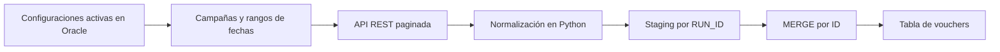

# Voucher ETL con Python y Oracle

Pipeline para extraer vouchers desde una API REST paginada, normalizar fechas y consolidar registros en Oracle mediante staging y un `MERGE` final. Esta es una **adaptación pública del código aportado por Gary Valverde**: configuración externa, nombres de tablas genéricos y ejemplos ficticios. No contiene registros reales, logs ni direcciones de infraestructura de la implementación original.

## Para reclutadores

| Capacidad | Evidencia en este repositorio |
| --- | --- |
| Integración de APIs | Autenticación, paginación, timeout y reintentos en `obtener_pagina` |
| Transformación de datos | Mapeo de campos y conversión ISO 8601 de UTC a UTC-4 |
| Carga por lotes | `executemany`, tamaños configurables y staging separado por `RUN_ID` |
| SQL Oracle | `MERGE` set-based con `ROW_NUMBER` para consolidar IDs |
| Manejo de fallos | Tabla final actualizada después de completar la extracción; staging conservado ante error |
| Verificación | Pruebas aisladas de fechas, lotes, reintentos, paginación y rechazo de ID ausente |

**Revisión sugerida:** ejecutar la demo, revisar `preparar_fila`, `cargar_lote`, `SQL_MERGE_FROM_STAGING` y las pruebas. No se atribuyen a este repositorio dashboards Power BI ni un modelo dimensional que no estén implementados aquí.

## Demo en menos de un minuto

Python 3.10 o superior. La demo y las pruebas no requieren dependencias, credenciales, API ni Oracle.

```bash
python demo_offline.py
python -m unittest -v
```

La demo transforma tres vouchers ficticios y genera `output/vouchers_demo.csv`. Permite comprobar el mapeo y el cambio de fecha al cruzar medianoche en UTC-4. **La demo no ejecuta la API ni el MERGE.** Las pruebas de integración se simulan con mocks; no equivalen a una validación contra Oracle real.

## Arquitectura



El proceso lee configuraciones activas, autentica una sesión y solicita páginas. Cada página se transforma y se inserta por lotes en staging. Tras completar todas las campañas se aplica una operación set-based a la tabla final. Solo después se limpia el staging de esa ejecución.

## Integración conectada

`voucher_etl.py` conserva el flujo de integración del proyecto. Ejecutarlo requiere un entorno de prueba autorizado y un contrato API compatible: login con campos `username` y `password`, respuesta con `token`, y GET paginado que devuelva una lista de vouchers. Los nombres exactos de autenticación deben contrastarse con el contrato de la API antes de conectar.

1. Instalar `python -m pip install -r requirements.txt` en un entorno virtual.
2. Revisar y crear las tablas del [esquema de ejemplo](schema.sql) en una base de prueba.
3. Configurar las variables indicadas en `.env.example` en el entorno del proceso. El script no carga archivos `.env` automáticamente.
4. Añadir una configuración ficticia en `VOUCHER_CONFIG` acorde con la API de prueba.
5. Ejecutar `python voucher_etl.py`.

Por defecto se utiliza el modo Thin del driver; `ORACLE_CLIENT_LIB_DIR` habilita el cliente local cuando se necesite modo Thick. No se verificó la integración conectada en esta sesión.

## Decisiones y límites conocidos

- Staging se confirma por lote para no mantener abierta una transacción durante toda la descarga. La tabla final se modifica en el `MERGE` posterior; una extracción incompleta deja staging para diagnóstico.
- La clave de consolidación es `ID`. Debe ser globalmente única entre campañas; de lo contrario, el contrato y el `MERGE` requieren una clave compuesta.
- Se actualizan registros coincidentes y se insertan los nuevos; no se eliminan vouchers que desaparezcan de la fuente. No hay watermark ni CDC.
- Los IDs duplicados en staging se ordenan por `STAGED_AT`; si dos filas tienen la misma marca temporal, falta un desempate adicional determinista. Es un punto de mejora documentado.
- Fechas inválidas se convierten en nulos con advertencia; no hay cuarentena ni contrato completo de tipos. El ID ausente detiene la campaña.
- Los reintentos son generales, con espera lineal; no implementan renovación de token ni tratamiento específico de 429/`Retry-After`.
- La limpieza por antigüedad de staging no comprueba un registro de ejecuciones activas: no se debe asumir protección para ejecuciones de más de siete días.
- No se incluyen orquestación, despliegue, benchmark ni resultados comerciales medidos. El esquema de ejemplo se preparó para explicar el código y debe validarse con Oracle antes de utilizarse.

## Autor

**Gary Valverde — Data Engineer y Business Intelligence**

[Perfil](https://github.com/gg-valverde) · [LinkedIn](https://www.linkedin.com/in/gary-german-valverde-quisbert-6b69231ab/) · [Contacto](mailto:gvalverdequisbert@gmail.com)

La preparación documental, la adaptación pública y las pruebas se realizaron con asistencia de IA. El script de integración procede del proyecto compartido por el autor.
